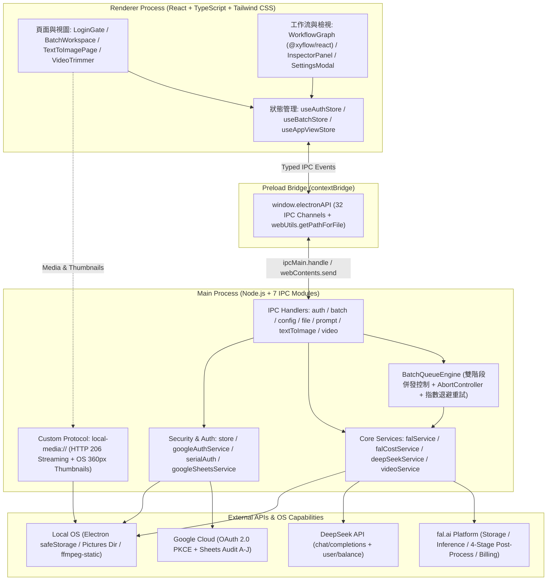
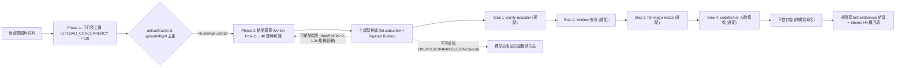

<div align="center">


# Wishful AI Draw

**基於 Electron、React 與 TypeScript 打造的企業級 AI 影像批次風格化、文字生圖與影片抽幀桌面工作站**

[](./package.json)
[](./electron.vite.config.ts)
[](./src/renderer/src/App.tsx)
[](./tailwind.config.js)
[](./src/main/services/falService.ts)
[](./src/main/services/deepSeekService.ts)
[](./electron-builder.yml)

[核心亮點](#-核心亮點) •
[詳細功能介紹](#-詳細功能介紹) •
[技術架構](#-技術架構) •
[快速開始](#-快速開始與設定) •
[指令與測試](#-常用指令與打包) •
[專案結構](#-專案結構)

</div>

---

## ✨ 核心亮點

**Wishful AI Draw** 是一款專為高吞吐影像製作與團隊協作設計的跨平台桌面應用程式。透過雙工作區設計將 **「批次影像風格化（Image Stylize）」** 與 **「文字生成圖片（Text-to-Image）」** 整合於單一工作流，並內建 **影片剪輯抽幀器**、**可視化節點流程圖**、**DeepSeek AI 提示詞優化**、**雙層成本結算** 與 **Google 雲端權限／稽核系統**。

| 模組面向 | 關鍵能力摘要 |
| :--- | :--- |
| **🔐 權限閘道與資安** | Google OAuth 2.0 Loopback + PKCE (`S256`) 白名單驗證、序列號授權登入、RBAC 角色徽章、`safeStorage` 本機加密 |
| **🎨 批次影像風格化** | 雙階段高併發佇列（10 路平行上傳 + `1 ~ 40` 動態運算池）、3 種檢視視圖、4 階段 AI 後製管線與前後對比滑桿 |
| **🪄 文字生圖工作室** | 內建 **179 個**文生圖／參考圖編輯模型、最多支援 **10 張**參考圖輸入、5 種畫幅比例與本地畫廊燈箱 |
| **🎬 影片精準抽幀器** | 自訂 `local-media://` HTTP 206 位元組串流播放、膠捲縮圖時間軸、NLE 快捷鍵與 `ffmpeg-static` 多 FPS PNG 抽幀 |
| **🧠 智慧提示詞與計費** | DeepSeek 結構化提示詞優化與餘額監控、fal.ai 實際帳單查詢＋預估雙層計價、Dry-Run 無耗損模擬模式 |
| **📊 雲端使用稽核** | 非同步序列化寫入 Google Sheets 10 欄稽核紀錄（UTC+8），支援非阻塞背景成本回填 |

---

## 🚀 詳細功能介紹

### 1. 🔐 強制安全登入閘道與角色權限控管 (Auth Gate & RBAC)

應用程式啟動後會經過 `LoginGate` 驗證層，確保所有 API 資源與使用紀錄皆可追蹤歸屬：

* **雙軌登入驗證機制**：
  * **Google OAuth 2.0 + PKCE (`S256`)**：透過本機隨機迴環埠 (`127.0.0.1:0`) 安全完成瀏覽器授權交換，自動比對 Google Sheets (`allowedAccounts`) Gmail 白名單，並讀取對應的 **RBAC 角色標籤**（顯示金色 `管理員` 徽章或 `一般使用者` 徽章）。
  * **序列號授權登入**：支援無 Google 帳號環境下的專屬序號登入，透過 Google Sheets (`serialSheet`) 驗證有效性並自動回寫登入時間與狀態至 B–D 欄。
* **安全工作階段保存**：Google 工作階段 (`google-auth.json`) 與序列號工作階段 (`serial-auth.json`) 採用互斥管理並透過 Electron `safeStorage` 進行作業系統層級加密，所有 OAuth 憑證與 API 金鑰僅存活於 Main Process，不外洩至前端渲染層。

---

### 2. 🖼️ 批次影像風格化工作區 (Batch Image Stylize)

專為大量素材轉換與微調打造的多維度工作區，支援 **檔案總管拖放**（經由 Preload `webUtils.getPathForFile` 解析真實路徑）、**資料夾遞迴匯入** 與 **影片抽幀直接入列**。

#### 三種工作區檢視模式 (`split` / `workflow` / `grid`)
1. **分欄模式 (`split`)**：左側清單佇列搭配右側互動檢查器與節點狀態，兼顧選取效率與單圖細節審查。
2. **節點畫布 (`workflow`)**：以 `@xyflow/react` 構建即時唯讀 DAG 工作流畫布，依目前設定動態串接節點：`InputNode` → `PreProcessNode` → `FalApiNode` → 動態可選後製節點（`UpscaleNode` / `FeatureNode`）→ `OutputNode`。
3. **網格畫廊 (`grid`)**：透過原生 OS 縮圖快取呈現 360×360 高效瀏覽網格，支援依狀態篩選（`all` / `idle` / `active` / `completed` / `failed`）、`Cmd/Ctrl+Click` 多選與右鍵選單（`BatchItemContextMenu`）。

#### 豐富的模型庫與 4 階段串聯後製管線
* **280 個同步圖生圖模型 ＋ 6 個精選預設模型**：預設採用 `fal-ai/gpt-image-2.6-sunburst/edit`，支援 OpenAPI Schema 能力自動識別、**自訂 Endpoint ID** 與 **Custom JSON 參數深度合併**，可針對單張圖片設定專屬 `customPrompt` 覆寫全域提示詞。
* **4 階段循序 AI 後製管線**（任一後製階段發生錯誤時僅記錄警告並保留前一階段輸出 URL，確保主生成結果不遺失）：

| 階段 | 處理功能 | fal.ai 模型端點 | 主要支援參數與特性 |
| :---: | :--- | :--- | :--- |
| **1** | **AI 畫質放大 (Upscale)** | `fal-ai/clarity-upscaler` | 放大倍率 `1 ~ 4`、`creativity`、`resemblance`、`guidanceScale`、`steps` |
| **2** | **智慧去背 (Background Removal)** | `fal-ai/birefnet` | `General Use (Light)` / `Heavy` / `Portrait`、解析度 `1024x1024` / `2048x2048`、`refineForeground`、`png`/`webp`/`gif` |
| **3** | **尺寸調整 (Resize)** | `fal-ai/fal-image-resize` | 自訂 `width` / `height`、裁切適應 `fit`（`cover`/`contain`/`fill`/`inside`）、輸出格式 `png`/`jpeg`/`webp` |
| **4** | **人臉修復 (Face Restore)** | `fal-ai/codeformer` | `fidelity` 保真度、`upscaleFactor`、`faceUpscale`、`aligned`、`onlyCenterFace` |

#### `InspectorPanel` 前後對比與細部檢視
* 提供可拖曳的 **互動式滑桿比對 (`slider`)** 與 **左右並排比對 (`side-by-side`)** 模式，即時檢視原圖與 AI 輸出差異。
* 完整呈現每張任務的 `requestId`、處理耗時、實際／預估花費、單圖即時處理日誌，以及單張失敗重試按鈕。

---

### 3. 🪄 文字生成圖片工作室 (Text-to-Image Studio)

獨立的文生圖與多圖參考創作介面，適合快速視覺發想與參考圖融合編輯：

* **179 個可用模型**：整合 `167` 個自動同步模型目錄與 `12` 個精選支援參考圖編輯的模型（以 `★` 標記，如 `nano-banana-pro/edit`、`flux-3/edit-image`、`seedream`、`gpt-image-2/edit`、`kling-image/o1`、`vidu`、`bria/fibo-2/edit` 等，預設模型為 `google/nano-banana-2.1`）。
* **多參考圖與版面參數**：支援上傳最多 **10 張參考圖** (`MAX_REFERENCE_IMAGES = 10`)，提供 5 種常用畫幅比例：
  * `1:1` (`1024×1024`) · `16:9` (`1344×768`) · `9:16` (`768×1344`) · `4:3` (`1152×896`) · `3:4` (`896×1152`)
* **提示詞模式／對話模式**：同一頁可切換兩種工作流程。對話模式由 **DeepSeek Flash (`deepseek-flash`)** 驅動，支援視覺輸入（看圖）、繁體中文討論、模型推薦與提示詞整理；當需求明確時，DeepSeek 會直接把生圖任務交接給 **fal.ai** 指定模型，並將結果帶回對話。使用者在對話模式也能先用與提示詞模式相同的下拉選單指定模型。
* **對話附件雙用途**：在對話框上傳的圖片可透過「看圖」提供給 DeepSeek 視覺理解，也可透過「參考」作為 fal.ai 生成參考圖（可同時開啟）；對話中較早的參考圖會保留給後續生成使用。
* **彈性生成與畫廊管理**：支援單次產出 `1` / `2` / `4` 張圖、切換 `png` / `jpeg` 格式與內建風格預設模板；產出結果自動保存至 `<Pictures>/Wishful_Ai_Draw/文生圖`，並支援燈箱預覽與「另存新檔」。

---

### 4. 🎬 影片剪輯與高效率抽幀器 (Video Trimmer & Frame Extractor)

直接於桌面端內建專業非線性剪輯體驗，將影片精華片段一鍵轉換為批次 AI 風格化素材：

* **廣泛格式與硬體級順暢拖曳**：支援 `.mp4`、`.mov`、`.webm`、`.mkv`、`.avi`、`.m4v`，透過自訂 `local-media://` 協定實現 HTTP `206 Partial Content` 位元組範圍串流，高畫質大檔時間軸刷幀零延遲。
* **免 `ffprobe` 膠捲時間軸 (`FilmstripTimeline`)**：利用內嵌 `ffmpeg-static` 快速產出 `8 ~ 24` 張連續預覽縮圖 (`scale=160:-1`)，直覺框選 In / Out 區間。
* **剪輯師級別鍵盤快捷鍵**：
  * `Space`：播放 / 暫停
  * `J` / `K` / `L`：1x–4x 倒轉穿梭 / 暫停 / 快轉穿梭
  * `I` / `O`：標記入點 (In) / 出點 (Out)
  * `Q` / `W` 或 `↑` / `↓`：快速跳轉至入點 / 出點
  * `←` / `→`：逐幀微調（搭配 `Shift` ±1 秒）
  * `Home` / `End` / `Esc`：跳至片頭 / 片尾 / 關閉視窗
* **自動入列抽幀**：可選擇 `4` / `8 (預設)` / `12` / `16` / `24` FPS，將選取區間輸出為無損 PNG 序列至系統暫存資料夾，完成後自動匯入批次待處理清單。

---

### 5. 🧠 DeepSeek AI 提示詞優化與餘額監控

* **結構化提示詞引擎**：整合 DeepSeek `deepseek-chat` API（30 秒請求逾時保護），依據 **`主體 → 構圖 → 場景 → 光線 → 材質 → 鏡頭 → 風格`** 專業結構自動擴寫並翻譯為高精度英文 Prompt，同時於 Google Sheets 記錄 `Prompt word_optimization` 事件。
* **TopBar 即時餘額面板**：內建 `DeepSeekBalancePanel`（8 秒查詢逾時），隨時掌握帳戶可用餘額狀態。

---

### 6. 💰 雙層成本估算／實算、模擬模式與智慧存檔

* **事前預估 ＋ 事後實算 (`falCostService`)**：
  * `BottomActionBar` 於開工前依據各模型定價與 `ASSUMED_OUTPUT_MEGAPIXELS = 1` 估算批次總成本；`TopBar` 即時顯示 fal.ai 錢包餘額 (`account/billing?expand=credits`)。
  * 單張完成後優先向 fal.ai `billing-events?request_id=...` 查詢真實扣款金額；若帳單尚未落盤或無權限，自動降級呼叫 `pricing/estimate`（優先 `historical_api_price`，次之 `unit_price`），並以 Per-Endpoint 快取與 `403` `billingDenied` 熔斷鎖存避免無效重複請求。
* **Dry-Run 模擬模式 (`mockMode`)**：於設定切換啟用（預設不持久化至磁碟，每次啟動重置為關閉），模擬流程會輸出至 `image_generated_SIM`，讓團隊在不消耗任何 API 額度的情況下完整測試佇列與檔案命名規則。
* **防覆寫智慧存檔 (`imageDownloader` / `outputDirectories`)**：
  * 預設自動建立並儲存至系統圖片目錄：`<Pictures>/Wishful_Ai_Draw`（批次風格化）與 `<Pictures>/Wishful_Ai_Draw/文生圖`（文字生圖）。
  * 支援 `{original_name}`、`{timestamp}`、`{index}` 命名模板（預設 `{original_name}_ai_{timestamp}`），同名衝突自動遞增 `_1`、`_2` 後綴保護既有檔案。

---

### 7. 📊 Google Sheets 企業級雲端稽核紀錄

透過序列化非同步佇列 (`usageLogger.ts` + `googleSheetsService.ts`) 確保在 40 路高併發場景下依然能精準寫入雲端稽核表而不互相覆蓋：

* **Sheet1（使用與成本稽核表）**：依台灣時間 (`UTC+8`) 自動寫入 A–J 共 10 個欄位（時間、使用者身分、動作類型、模型 ID、狀態、耗時等），並在取得 fal.ai 實際帳單金額後於背景非阻塞回填 H / I 欄成本欄位。
* **Sheet2（`serialSheet` 序號授權表）**：管理可用序號與開通／登入狀態回寫。
* **Sheet3（`allowedAccounts` 白名單與權限表）**：控管允許登入的 Gmail 帳號與對應的 RBAC 角色標籤。

---

## 📐 技術架構

### 整體進程與分層架構

應用程式嚴格遵守 Electron **安全隔離設計**（`contextIsolation: true`、`nodeIntegration: false`），所有檔案系統存取、FFmpeg 運算、API 金鑰加解密與第三方雲端通訊皆封裝於 Main Process，Renderer 僅透過 Preload 暴露的 `window.electronAPI` 與定義於 `src/shared/ipc-channels.ts` 的 **32 個強型別 IPC 通道** 進行雙向通訊。



### 高併發批次引擎管線 (`BatchQueueEngine`)

為了最大化大規模圖集的處理吞吐量並防止頻寬塞車或 API 限流，批次引擎採用 **「預上傳去重」＋「動態運算 worker pool」＋「非阻塞成本回填」** 的兩階段架構：



### 核心架構設計亮點

1. **自訂特權協定 `local-media://` (`localMediaProtocol.ts` & `localFileResponse.ts`)**
   * **影片無縫拖曳**：針對本地影片檔案請求自動解析 HTTP `Range` 標頭並回傳 **`206 Partial Content`** 分段串流，使 `<video>` 元素無須整檔載入即可精準跳轉至任意影格。
   * **輕量化縮圖快取**：當 Renderer 要求圖片預覽時，透過 Electron `nativeImage.createThumbnailFromPath` 即時向作業系統請求 **360×360 (JPEG quality 82)** 原生縮圖，大幅降低網格畫廊瀏覽數百張高解析圖檔時的記憶體峰值。
2. **模型目錄自動同步與 Schema 驅動組裝 (`falPayloadBuilder.ts`)**
   * 透過 `scripts/sync-fal-models.mjs` 與 `scripts/sync-fal-text-to-image.mjs` 自動拉取模型清單並產生強型別目錄（`src/shared/falModelCatalog.ts`、`src/shared/falTextToImageCatalog.ts`）。
   * 執行期由 `falPayloadBuilder.ts` 依據不同模型家族（如 Diffusion 與 GPT Image 原生參數差異）動態組裝 Payload、剔除模型標記的 `unsupportedFields`，再深度合併使用者的 `customJsonParams`。
3. **跨平台打包與原生工具鏈內嵌 (`electron-builder.yml`)**
   * `ffmpeg-static` 與 `resources/**` 皆設定於 `asarUnpack`，`videoService.ts` 會在打包執行環境自動將 `app.asar` 路徑重寫為 `app.asar.unpacked`，確保無須使用者預先安裝系統 FFmpeg 即可直接運行抽幀與時間軸縮圖生成。
4. **安全敏感資料保護 (`store.ts`)**
   * 所有使用者自填的 `falApiKey`、`deepseekApiKey` 與登入 Token 檔案 (`wishful-settings.json`、`google-auth.json`、`serial-auth.json`) 皆以 Electron `safeStorage` 進行作業系統鑰匙圈／DPAPI 加密存儲，無明文金鑰落地風險。

---

### 核心技術棧 (Tech Stack)

| 層級 | 選用技術與套件 | 用途與角色 |
| :--- | :--- | :--- |
| **桌面框架與建置** | Electron · `electron-vite` · `electron-builder` | 跨平台桌面容器、Main/Preload/Renderer 熱重載建置與 macOS/Windows 安裝包打包 |
| **前端視圖與樣式** | React · TypeScript · Tailwind CSS · `lucide-react` | 高密度暗色專業創作介面、響應式切版與圖示系統 |
| **狀態與流程圖** | Zustand · `@xyflow/react` | 輕量化視圖／認證／佇列狀態管理，以及即時可視化節點流程圖 |
| **AI 推論與提示詞** | `@fal-ai/client` · DeepSeek Chat API | 圖生圖、文生圖、4 階段後製運算，以及提示詞擴寫翻譯與雙邊帳戶餘額監控 |
| **影音與媒體處理** | `fluent-ffmpeg` · `ffmpeg-static` · `local-media://` | 內嵌跨平台轉碼引擎、時間軸膠捲縮圖生成與 206 Byte-Range 本地串流 |
| **雲端授權與稽核** | `googleapis` · OAuth 2.0 Loopback PKCE | 企業內部 Google Sheets 白名單／序號驗證、RBAC 權限與 UTC+8 使用稽核 |
| **測試框架** | Vitest | 涵蓋 41 份測試檔的單元測試與核心引擎行為驗證 |

---

## 📁 預設儲存資料夾

第一次進入應用程式時，會自動在 macOS「圖片」中建立以下資料夾結構（若手動刪除，下次進入時也會自動重建）：

```
~/Pictures/
└── Wishful_Ai_Draw/        ← 影像風格化預設輸出資料夾
    ├── 文生圖/             ← 文字生成圖片固定輸出資料夾
    └── 文生影片/           ← 文字生成影片輸出資料夾
```

- 頂部工具列（TopBar）會依目前頁面顯示對應的輸出資料夾：
  - **影像風格化**：顯示 `Wishful_Ai_Draw`，點擊可直接在 Finder 開啟；右側齒輪可更換輸出資料夾。
  - **文字生成圖片**：顯示 `文生圖`，點擊可直接在 Finder 開啟。
- 文字生成圖片的生成結果一律自動儲存到 `圖片 / Wishful_Ai_Draw / 文生圖`，不佔用影像風格化的自訂輸出設定。

---


## 🔧 快速開始與設定

### 環境需求
* **Node.js**（建議 LTS 版本）與 **npm**
* macOS (`arm64` / `x64`) 或 Windows (`x64`)

### 1. 安裝依賴並啟動開發模式

```bash
# 安裝所有依賴套件
npm install

# 啟動 Electron + Vite 開發伺服器
npm run dev
```

### 2. Google 登入與雲端稽核設定（選用／企業部署）

若需自架或重設 Google OAuth 2.0 用戶端憑證與 Service Account（用於存取 Google Sheets 稽核紀錄、序號表與帳號白名單），請完整參閱專案內建指南：

* 📖 **[Google OAuth 與 Sheets 完整設定指南](./resources/GOOGLE_SETUP.md)**

專案亦提供輔助腳本方便驗證與匯入設定：

```bash
# 檢查目前 Google 憑證與設定完整性
node scripts/check-google-setup.cjs

# 快速匯入 Service Account 憑證檔案
node scripts/import-service-account.cjs
```

> [!IMPORTANT]
> 本專案的 `.gitignore` 已預設忽略 `resources/google-credentials.json`、`resources/google-service-account.json` 與 `.env*` 等機敏憑證檔案，請勿將實際金鑰提交至公開版本庫。

---

## 📦 常用指令與打包

| 指令 | 說明 |
| :--- | :--- |
| `npm run dev` | 啟動 `electron-vite dev` 開發模式 |
| `npm run start` | 以 `electron-vite preview` 預覽已建置的應用程式 |
| `npm run build` | 執行類型檢查 (`typecheck`) 並建置生產環境檔案 |
| `npm run build:mac` | 建置並封裝 macOS 安裝檔（`dmg` / `zip`，支援 `arm64` & `x64`） |
| `npm run build:win` | 建置並封裝 Windows 安裝檔（`nsis` / `portable`，支援 `x64`） |
| `npm test` | 執行 `tests/**/*.test.ts` 全套 Vitest 單元測試（共 41 份測試檔） |
| `npm run typecheck` | 執行專案整體 TypeScript 型別檢查 |
| `npm run lint` | 執行 ESLint 程式碼靜態品質檢查 |
| `npm run format` | 使用 Prettier 格式化原始碼 |
| `npm run sync:fal` | 一鍵同步最新的 fal.ai **圖生圖** 與 **文生圖** 模型目錄 |
| `npm run sync:fal-models` | 僅同步圖生圖模型目錄至 `src/shared/falModelCatalog.ts` |
| `npm run sync:fal-text-to-image` | 僅同步文生圖模型目錄至 `src/shared/falTextToImageCatalog.ts` |

---

## 📁 專案結構

```text
Wishful_Ai_Draw/
├── electron.vite.config.ts              # Main / Preload / Renderer 建置設定與路徑別名 (@shared, @renderer)
├── electron-builder.yml                 # macOS / Windows 打包設定與 ffmpeg-static 解包規則
├── package.json                         # 專案相依套件與開發／同步／打包腳本
├── tailwind.config.js                   # Tailwind CSS 主題與登入頁面動態動畫設定
├── vitest.config.ts                     # Vitest 單元測試環境配置 (tests/**/*.test.ts)
├── resources/
│   └── GOOGLE_SETUP.md                  # Google OAuth 2.0 與 Sheets 三分頁架構設定手冊
├── scripts/
│   ├── sync-fal-models.mjs              # 自動同步圖生圖模型目錄腳本
│   ├── sync-fal-text-to-image.mjs       # 自動同步文生圖模型目錄腳本
│   ├── check-google-setup.cjs           # Google 憑證設定檢查腳本
│   └── import-service-account.cjs       # Service Account JSON 匯入工具
├── tests/                               # 41 份 Vitest 測試套件（涵蓋引擎、計費、協議、認證與元件邏輯）
└── src/
    ├── main/                            # Electron Main Process
    │   ├── index.ts                     # 應用程式生命週期、視窗隔離、local-media 特權協定與 IPC 註冊
    │   ├── ipc/                         # 7 大領域 IPC 處理器
    │   │   ├── auth.ipc.ts              # Google OAuth / 序號登入 / 登出
    │   │   ├── batch.ipc.ts             # 批次佇列開始、暫停、繼續、取消與重試
    │   │   ├── config.ipc.ts            # 本機安全設定、模型目錄與餘額查詢
    │   │   ├── file.ipc.ts              # 檔案對話框、資料夾掃描與另存圖片
    │   │   ├── prompt.ipc.ts            # DeepSeek AI 提示詞優化
    │   │   ├── textToImage.ipc.ts       # 文字生成圖片執行與存檔
    │   │   └── video.ipc.ts             # 影片膠捲縮圖產生與指定區間抽幀
    │   └── services/                    # 核心業務與系統服務單例
    │       ├── batchQueueEngine.ts      # 兩階段高併發引擎、重試與後製串聯調度器
    │       ├── falService.ts            # fal.ai 檔案上傳快取、推論與 4 階段後製呼叫
    │       ├── falPayloadBuilder.ts     # Schema 驅動參數組裝與 Custom JSON 合併
    │       ├── falCostService.ts        # billing-events 實算 / pricing estimate 雙層計價與餘額查詢
    │       ├── deepSeekService.ts       # DeepSeek Prompt 優化與帳戶餘額查詢
    │       ├── textToImageService.ts    # 文生圖推論與多參考圖封裝
    │       ├── videoService.ts          # 內嵌 ffmpeg-static 影片縮圖與 PNG 抽幀服務
    │       ├── localMediaProtocol.ts    # local-media:// 協定註冊與安全路徑校驗
    │       ├── localFileResponse.ts     # HTTP 206 Byte-Range 串流與 360px OS 原生縮圖回應
    │       ├── imageDownloader.ts       # 產出圖片下載與防覆寫命名處理
    │       ├── outputDirectories.ts     # 系統圖片預設輸出路徑管理
    │       ├── store.ts                 # safeStorage 加密設定儲存與 Mock 模式開關
    │       ├── googleAuthService.ts     # Google 工作階段生命週期管理
    │       ├── googleOAuthPkce.ts       # Loopback (127.0.0.1:0) + PKCE (S256) 授權流程
    │       ├── googleSheetsService.ts   # Google Sheets 3 分頁讀取、白名單與成本回填
    │       ├── allowedAccounts.ts       # Gmail 帳號白名單解析
    │       ├── userRoleService.ts       # RBAC 角色查詢與標準化
    │       ├── serialAuth.ts            # 序號加密工作階段管理
    │       ├── serialKeyService.ts      # 序號驗證與 Sheet2 狀態回寫
    │       ├── usageLogger.ts           # 非同步序列化雲端稽核日誌佇列
    │       ├── usageLoggerWiring.ts     # 稽核事件接線與成本回填協調
    │       └── taiwanTime.ts            # UTC+8 台灣時間格式化工具
    ├── preload/
    │   └── index.ts                     # contextBridge 暴露 window.electronAPI 與檔案路徑取得介面
    ├── shared/                          # Main / Preload / Renderer 共用型別與常數
    │   ├── ipc-channels.ts              # 32 個 IPC 雙向通道常數定義
    │   ├── types.ts                     # 應用程式核心介面與預設圖生圖精選模型
    │   ├── concurrency.ts               # MAX_BATCH_CONCURRENCY = 40 併發上限限制器
    │   ├── falPricing.ts                # 費率格式化與批次成本估算函式
    │   ├── userRole.ts                  # 管理員 / 一般使用者 RBAC 常數與判斷
    │   ├── falModelCatalog.ts           # 280 個圖生圖模型自動同步目錄
    │   ├── falTextToImageModels.ts      # 整合 179 個文生圖模型與星號精選標記
    │   ├── falTextToImageCatalog.ts     # 167 個自動同步文生圖模型目錄
    │   └── falTextToImageExtraModels.ts # 12 個擴充支援參考圖編輯之精選模型
    └── renderer/src/                    # React 前端使用者介面
        ├── App.tsx                      # 根元件與雙工作區／登入閘道路由切換
        ├── store/                       # Zustand 狀態管理 (Auth / Batch / AppView)
        ├── utils/                       # 前端費用計算 (cost.ts) 與模型選項輔助 (modelOptions.ts)
        └── components/                  # 核心 UI 元件
            ├── LoginGate.tsx            # Google OAuth / 序號雙軌登入閘道
            ├── LoginBackdrop.tsx        # 登入頁面極光與網格動態背景
            ├── TopBar.tsx               # 工作區切換、角色徽章、fal/DeepSeek 餘額與設定入口
            ├── SidebarConfig.tsx        # 模型選擇、提示詞輸入、DeepSeek 優化與 4 階段後製開關
            ├── BatchWorkspace.tsx       # 分欄 / 節點畫布 / 網格畫廊三模式切換與篩選控制
            ├── BatchGridCard.tsx        # 網格卡片縮圖與進度狀態顯示
            ├── BatchItemContextMenu.tsx # 佇列項目右鍵快速操作選單
            ├── InspectorPanel.tsx       # Before/After 拖曳滑桿、單圖提示詞覆寫、日誌與成本檢視
            ├── BottomActionBar.tsx      # 1~40 即時併發調整、執行控制 (開始/暫停/取消) 與費用預估
            ├── SettingsModal.tsx        # API 金鑰管理、輸出路徑命名模板與 Mock 模式設定
            ├── DeepSeekBalancePanel.tsx # DeepSeek API 帳戶即時餘額微件
            ├── TextToImagePage.tsx      # 獨立文生圖工作室（參考圖上傳、畫幅選擇與本地畫廊燈箱）
            ├── VideoTrimmer.tsx         # 影片修剪與 FPS 抽幀整合對話視窗
            ├── video/                   # 影片播放器 hooks、FilmstripTimeline 與 VideoPreview
            └── workflow/                # @xyflow/react 即時管線畫布與 6 種動態節點元件
```
